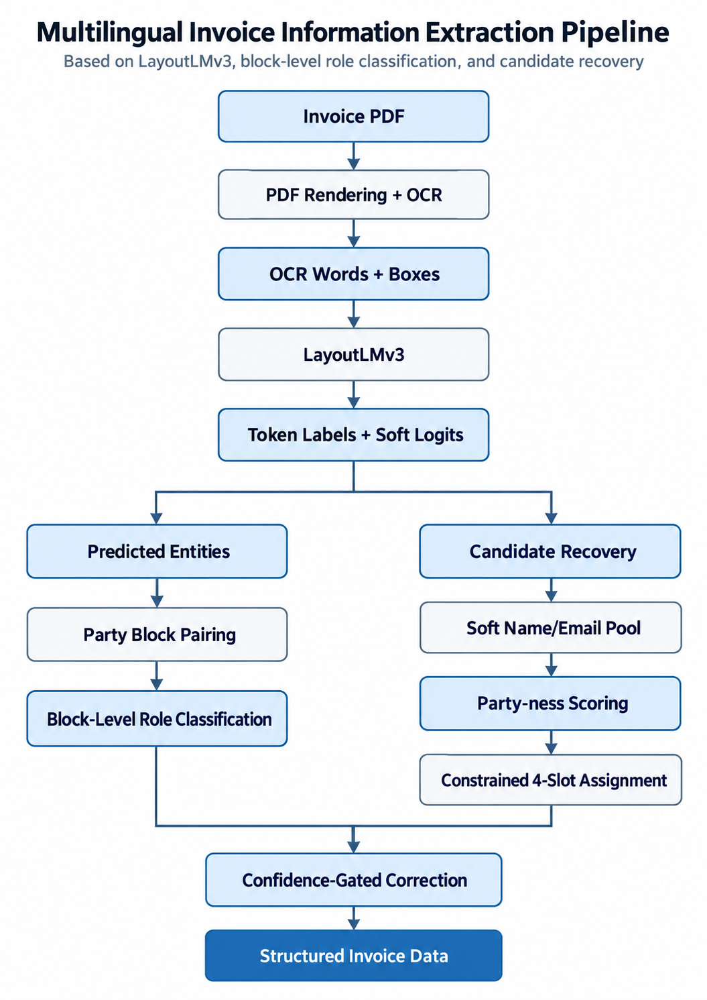

# Intelligent Invoice Information Extraction Using LayoutLMv3

An end-to-end **Document AI system** for extracting structured information from multilingual invoices using **LayoutLMv3, block-level role classification, and document-level candidate recovery**.

The system combines multimodal document understanding with relationship-aware postprocessing to address a common challenge in invoice extraction: correctly distinguishing **seller information from client information**, even across different layouts and multiple pages.

## Overview

Traditional invoice extraction systems often struggle with varying document layouts, multilingual content, and ambiguous entities. In particular, names and email addresses may be detected correctly but assigned to the wrong party.

This project develops a multi-stage invoice information extraction pipeline that combines:

- **LayoutLMv3** for token-level information extraction.
- **Block-level role classification** for seller/client disambiguation.
- **Soft candidate recovery** for missing or misclassified entities.
- **Document-level constrained assignment** for structured field extraction.
- **Confidence-based fallback** to reduce unnecessary corrections.

The system is developed using PyTorch and Hugging Face Transformers, with experiments conducted in Kaggle Notebooks.

## Extracted Information

The system extracts 11 invoice fields.

| Category | Fields |
|---|---|
| Invoice Details | Invoice Number, Invoice Date, Due Date, Reference |
| Seller Information | Seller Name, Seller Email |
| Client Information | Client Name, Client Email |
| Financial Information | Subtotal, Tax, Total Due |

## System Architecture

<p align="center">
  
</p>

### Stage 1: LayoutLMv3 Information Extraction

The initial model is `microsoft/layoutlmv3-base`, fine-tuned for BIO token classification with 23 output classes.

Inputs include:

- Rendered invoice page images.
- OCR-extracted words.
- Normalized bounding boxes.
- Token-level attention masks.

Documents exceeding the 512-token limit are divided into overlapping windows, with predictions reconstructed at their original OCR positions.

### Stage 2: Seller/Client Role Disambiguation

The first-stage model sometimes correctly identifies a name or email but assigns it to the wrong party.

A lightweight second-stage classifier evaluates complete party blocks using:

- Seller-versus-client token logit margins.
- Multilingual heading embeddings.
- Relative spatial relationships.
- Document reading-order information.

A pairwise/listwise classification approach determines which block represents the seller and which represents the client.

The role classifier uses out-of-fold predictions to reduce dependence on overconfident in-sample model outputs.

### Stage 3: Document-Level Candidate Recovery

Strict block pairing can fail when entities are missing, incorrectly labeled, or distributed across multiple pages.

The candidate recovery module addresses these limitations through:

1. **Soft candidate generation:** Combines token probabilities, predicted spans, OCR email detection, and heading-based name candidates.
2. **Boundary recovery:** Uses OCR line segments to recover incomplete company names.
3. **Cross-page pooling:** Collects candidates from all pages of an invoice.
4. **Party-ness scoring:** Distinguishes party entities from unrelated organizations, such as bank names.
5. **Constrained assignment:** Assigns candidates to four slots—`SELLER_NAME`, `SELLER_EMAIL`, `CLIENT_NAME`, and `CLIENT_EMAIL`—while preventing duplicate assignments.
6. **Confidence-gated correction:** Retains existing predictions when the new assignment lacks sufficient evidence.

The original LayoutLMv3 model remains unchanged throughout these additional stages.

## Dataset

**Dataset:** [Generated Invoices — Kaggle](https://www.kaggle.com/datasets/jakubgal/generated-invoices)

The dataset contains synthetically generated invoices with PDF documents, OCR annotations, and structured ground-truth information.

| Property | Value |
|---|---|
| Complete invoices available | 746 |
| Total PDF pages | 1,169 |
| Strictly aligned labeled invoices | 189 |
| Training invoices | 151 |
| Validation invoices | 19 |
| Test invoices | 19 |
| Extracted fields | 11 |
| BIO classification classes | 23 |

Supported dataset languages include English, German, Czech, and Slovak.

The labeled subset uses automatically aligned OCR and ground-truth values. Therefore, the supervision should be considered **silver-standard rather than manually verified gold-standard annotations**.

Invoices are split at the document level to avoid placing pages from the same invoice in multiple dataset partitions.

## Experimental Results

### Validation Performance

| Metric | LayoutLMv3 | Two-Stage | Final Pipeline |
|---|---:|---:|---:|
| Overall Entity F1 | 97.13% | 98.09% | **99.52%** |
| Seller/Client F1 | 92.11% | 94.74% | **98.68%** |
| Email F1 | 92.11% | 94.74% | **97.37%** |
| Fully Correct Invoices | 15/19 | 16/19 | **18/19** |

The final pipeline improved invoice-level exact match from **78.95% to 94.74%** on the validation subset.

### Candidate Recovery Performance

| Metric | Result |
|---|---:|
| Validation invoices with all four gold party spans present in the candidate pool | 19/19 |
| Previously incorrect invoices recovered | 2/3 |
| Previously correct invoices regressed | 0/16 |
| Final validation invoice exact match | 18/19 |

### Client-First Layout Robustness

A controlled counterfactual experiment swapped seller and client blocks in 12 validation invoices.

| Method | Client-First Role F1 |
|---|---:|
| Original LayoutLMv3 | 18.75% |
| Two-Stage Role Classifier | **95.83%** |
| Always-First-Block-Is-Seller Heuristic | 0.00% |

The role classifier correctly assigned the seller/client roles in all 12 synthetic client-first block pairs.

These findings suggest that the second-stage classifier makes use of heading semantics rather than relying exclusively on fixed reading order.

### Original Model Test Baseline

The initial LayoutLMv3 model achieved **94.26% strict entity-level F1** on the 19-invoice test subset, before the additional correction stages.

The final pipeline's full test evaluation must be reported separately from the validation results above.

## Technologies Used

| Component | Technology |
|---|---|
| Deep Learning | PyTorch |
| Document Understanding | LayoutLMv3 |
| Model Framework | Hugging Face Transformers |
| Heading Embeddings | Multilingual MiniLM |
| Candidate Classification | Scikit-learn |
| Constrained Assignment | Python / SciPy-based optimization utilities |
| PDF Processing | PyMuPDF |
| Data Processing | NumPy, Pandas |
| Visualization | Matplotlib |
| Development Environment | Kaggle Notebooks |
| GPU | NVIDIA Tesla T4 |

## Getting Started

### 1. Prepare the Environment

The project was developed in Kaggle with GPU acceleration.

Install the main dependencies:

```bash
pip install torch transformers pymupdf scikit-learn scipy pandas numpy matplotlib pillow tqdm
```

Additional dependencies may be needed depending on the notebook environment and installed Transformers version.

### 2. Download the Dataset

Download the [Generated Invoices dataset](https://www.kaggle.com/datasets/jakubgal/generated-invoices), or attach it directly to a Kaggle Notebook.

The dataset provides invoice PDFs, OCR JSON files, and corresponding structured annotations.

### 3. Run the Pipeline

The current implementation uses sequential notebook-based experiments:

1. Prepare invoice pages, OCR words, bounding boxes, and silver BIO labels.
2. Fine-tune LayoutLMv3 for token classification.
3. Evaluate entity extraction and identify seller/client role errors.
4. Generate out-of-fold predictions and train the block-level role classifier.
5. Train candidate recovery and constrained slot-assignment components.
6. Apply the complete pipeline and evaluate the predictions.
7. Visualize predicted entities over the original invoice PDFs.

The trained model and auxiliary classifiers must be available before running inference. The notebook-based implementation should be refactored into reusable modules for standalone deployment.

## Example Output

The following JSON illustrates the intended output schema. Values are examples, not predictions from a particular invoice.

```json
{
  "invoice_number": "INV-2026-001",
  "invoice_date": "2026-09-10",
  "due_date": "2026-09-25",
  "reference": "PO-1025",
  "seller_name": "ABC Technologies Ltd.",
  "seller_email": "billing@abctech.com",
  "client_name": "XYZ Enterprises",
  "client_email": "accounts@xyz.com",
  "subtotal": "1500.00",
  "tax": "150.00",
  "total_due": "1650.00"
}
```

Missing or uncertain values should be represented explicitly rather than fabricated.

## Limitations

The current system has several limitations:

- Experiments use a relatively small labeled subset of synthetic invoices.
- Automatically aligned annotations may contain labeling errors.
- The reported final pipeline improvements are from 19 validation invoices.
- The validation set was repeatedly inspected during development, so the reported improvements may be optimistic.
- Synthetic client-first experiments do not replace independent real-world evaluation.
- Scanned documents require suitable OCR preprocessing.
- Candidate assignment remains sensitive to ambiguous or unusual document structure.
- Full template-disjoint and real-world robustness evaluations are still required.

## Future Work

- Evaluate the complete pipeline on independent, unseen invoice templates.
- Improve cross-page entity association and confidence calibration.
- Extend candidate recovery to more complex invoice layouts.
- Add scanned-PDF OCR support.
- Develop an interactive Gradio demonstration.
- Package the inference pipeline for standalone deployment.
- Explore broader multilingual invoice benchmarks.

## Research Takeaway

A document extraction model can successfully detect an entity while still assigning it to the wrong semantic role.

This project investigates that distinction by combining **token-level extraction with document-level entity association**.

The results indicate that relationship-aware classification and constrained candidate assignment can improve structured invoice extraction without retraining the original document encoder.

## Acknowledgments

- [Microsoft LayoutLMv3](https://huggingface.co/microsoft/layoutlmv3-base)
- [Hugging Face Transformers](https://github.com/huggingface/transformers)
- [Generated Invoices Dataset](https://www.kaggle.com/datasets/jakubgal/generated-invoices)
- [PyTorch](https://pytorch.org/)

---

**Project Status:** Research prototype — validation completed; independent end-to-end generalization evaluation and deployment packaging are ongoing.
